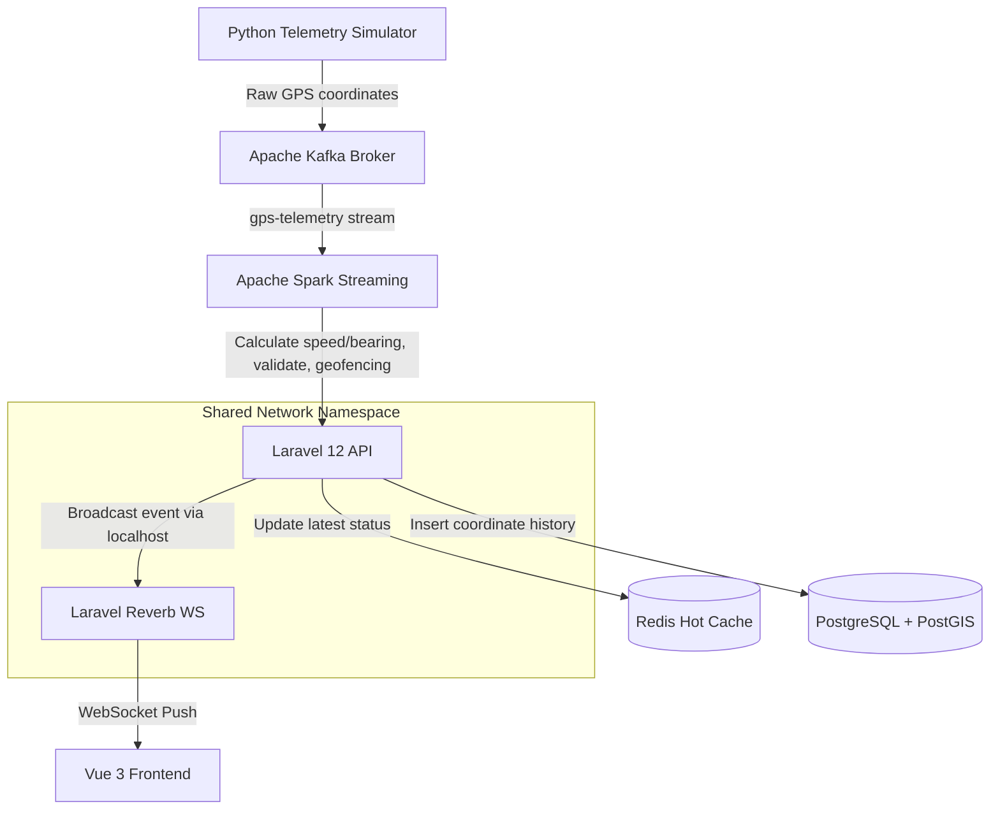

# Courier Radar - Live Fleet & Delivery Tracker

A real-time logistics and dispatch operations map-based dashboard. It showcases a decoupled, high-throughput telemetry ingestion pipeline using **Apache Kafka**, stream processing using **Apache Spark Streaming**, in-memory caching with **Redis**, spatial search using **PostgreSQL + PostGIS**, and instant WebSocket broadcasting using **Laravel Reverb** to drive a reactive **Vue 3 + Leaflet** frontend.

---

## 🏗️ Architecture



1. **Python Telemetry Simulator**: Mocks multiple delivery vehicles (tuk-tuks, vans, bikes, bicycles) moving dynamically along coordinate paths, publishing raw pings to Kafka.
2. **Apache Kafka (KRaft Mode)**: Ingests the high-frequency stream of telemetry events.
3. **Apache Spark Streaming**: Consumes raw coordinates, calculates real-time vehicle dynamics (speed, bearing heading), checks geofence entries/exits, and pushes validated payloads to the backend.
4. **Laravel 12 (PHP 8.4)**: Acts as the database orchestration gateway, receiving processed telemetry, caching the absolute latest coordinates in Redis, saving spatial location records in PostGIS, and firing WebSocket broadcasts.
5. **Laravel Reverb**: Handles high-performance WebSocket connections, broadcasting coordinates directly to active browser sessions.
6. **Vue 3 + Leaflet Frontend**: Displays real-time vehicle positions with smooth rotation and linear interpolation (no page refreshes). Includes a floating control panel, geofence zone boundary overlay, and a live alert logs feed.

---

## 🚦 System Port Map

| Component | Internal Container Port | Host Port Mapping | Purpose |
| --- | --- | --- | --- |
| **Vue 3 Frontend** | `5173` | `5173` | Interactive dashboard UI |
| **Laravel API Backend** | `8000` | `8005` | Telemetry handler endpoint |
| **Laravel Reverb WS** | `8080` (shared network) | `8090` (exposed via backend) | WebSocket broker daemon |
| **PostgreSQL + PostGIS** | `5432` | `5432` | Persistent database storage |
| **Redis Cache** | `6379` | `6379` | In-memory latest state cache |
| **Apache Kafka** | `29092` | `9092` | Decoupled message broker |

---

## 🛠️ Getting Started & User Manual

### 1. Prerequisites
- [Docker Desktop](https://www.docker.com/products/docker-desktop/) (v20+) installed and running.
- **WSL 2** configured (for Windows users).

### 2. Setup and Execution

1. **Launch the Container Stack**:
   Open a terminal in the root project directory and run:
   ```bash
   docker compose up -d
   ```
   *Note: This builds and configures all 8 container environments automatically. The initial launch may take a few minutes as base images are fetched and extensions compile.*

2. **Execute Database Migrations**:
   Once the containers are running, trigger Laravel's PostGIS migrations to initialize tables and spatial indices:
   ```bash
   docker compose exec backend php artisan migrate
   ```

3. **Access the Dashboard**:
   Open your web browser and navigate to:
   ```http
   http://localhost:5173
   ```

---

## 🖥️ Using the Dashboard

### 🛰️ Live Map Grid
- Vehicles are plotted as **colored arrows** representing their current direction (bearing heading).
- Hover over or click on any vehicle marker to open a details popup (speed, type, name, status, ID).
- The red dashed polygon on the map represents the **Galle Face Green Delivery Zone (A)** geofence.

### 📊 Fleet Directory Sidebar (Left)
- Displays stats (Total Assets, Moving, Idle, and Geofenced count).
- Lists all active vehicles sorted by status.
- **Interactive Focus**: Click on any vehicle row in the list. The map will smoothly fly (lerp) to center on that vehicle's current location and open its details popup.

### 🚨 System Log & Alerts (Right)
- Outputs a real-time event feed of system status changes.
- Shows instant alerts when a vehicle **enters** or **exits** the Galle Face Green geofence.
- Displays warning logs if a vehicle loses connection (transitions to *Offline* state if no pings are received for >8 seconds).

---

## ⚙️ Customization

### Configuring Geofence Zones
The geofence is defined in [spark/stream_processor.py](file:///d:/xampp/htdocs/Courier%20Radar/spark/stream_processor.py#L38-L41). You can alter the latitude/longitude boundary coordinates to adapt the geofence to any other location:
```python
# Galle Face Green (Colombo, Sri Lanka)
is_inside = (6.9240 <= lat <= 6.9300) and (79.8400 <= lng <= 79.8460)
```
*Note: Make sure to update the visual geofence coordinates in the frontend map file [frontend/src/App.vue](file:///d:/xampp/htdocs/Courier%20Radar/frontend/src/App.vue#L225) to sync the visual representation.*

---

## 🛑 Tear Down
To stop and clean up all resources, run:
```bash
docker compose down -v
```
This terminates the containers and deletes temporary network volumes.
